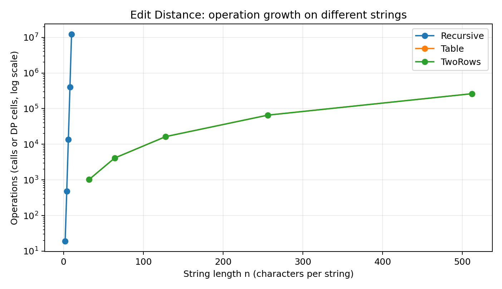
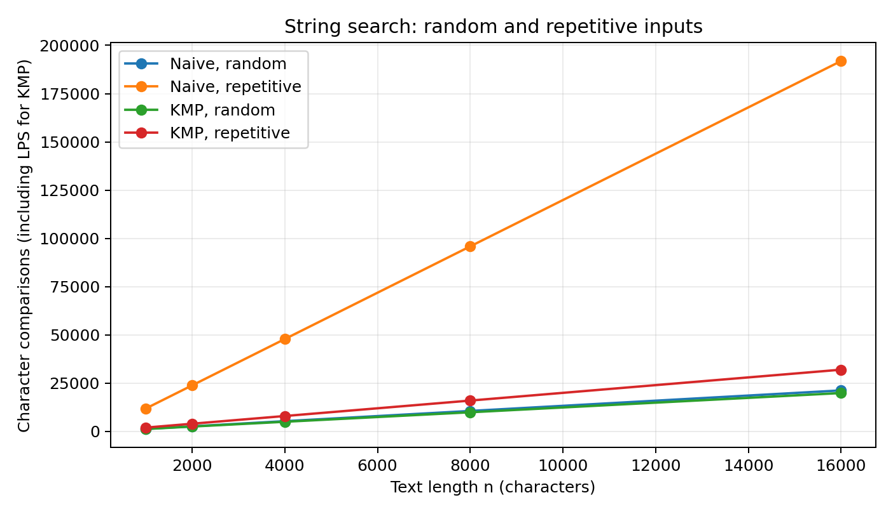
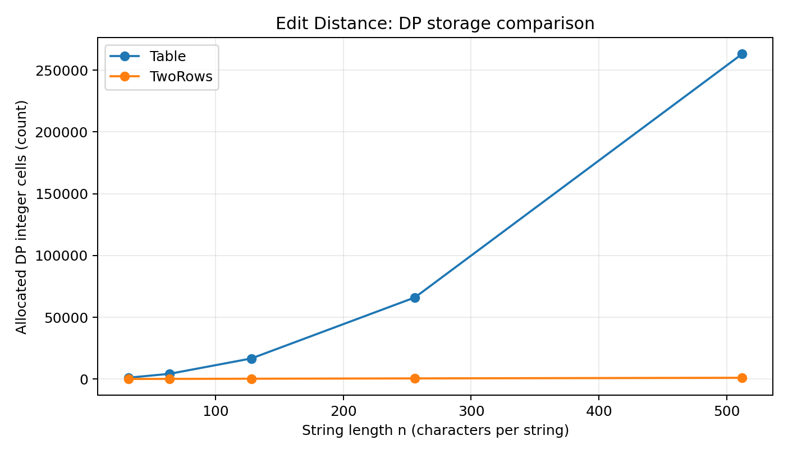

# Assignment 4: Dynamic Programming and String Algorithms
**Marlen Yerkinbayev | SE2518 | Design and Analysis of Algorithms**

## 1. Experiment Design Card (written before measurement)

| Field | Edit Distance | String Search |
|---|---|---|
| Question | How does the operation count grow for plain recursion versus full-table and two-row DP, and how much DP storage is saved? | When does Naive do much more work than KMP? |
| Sizes (n) | Recursive: **2, 4, 6, 8, 10**; Table and TwoRows: **32, 64, 128, 256, 512**. Recursion is deliberately kept small because it grows rapidly. | Text lengths **1000, 2000, 4000, 8000, 16000**; fixed pattern length **12**. |
| Inputs | **random**: two strings drawn from `a`–`d`; **different**: `a` repeated n times versus `b` repeated n times (no matching characters, expensive for recursion). | **random**: random text over `a`–`d` with a fixed 12-character pattern; **repetitive**: `a` repeated n times and pattern `aaaaaaaaaaab` (11 a's and one b), forcing many near-matches for Naive. |
| Metrics | Actual recursive calls or completed interior DP cells; median time in milliseconds from five repetitions; array storage in integer cells (analytical allocation counts). | Actual character comparisons during search (including LPS preprocessing for KMP); median time in milliseconds from five repetitions. |
| Prediction | Uncached recursion will increase much faster than quadratic DP. Table and TwoRows will compute equal numbers of cells, but TwoRows will allocate far fewer integer cells. | On random strings Naive and KMP may be comparable; on repetitive data Naive should make many more comparisons. KMP comparison count should grow approximately linearly in n. |
| Plots | Edit operation count on log scale; DP cell storage comparison. | Character comparison curves by input type. |

**Reproduction procedure.** `InputGenerator` uses seed `20261108`. Each size/input combination is independent of execution order. There is one warm-up call, followed by **five measured runs** using `System.nanoTime()`; the CSV retains every run, and plots use the median. The generator makes identical strings and operation counts on reruns. Wall-clock times can fluctuate because of OS scheduling, JIT and garbage collection. All measurements shown below were produced locally using OpenJDK 21; time results are machine-specific.

## 2. Plots and observations

**Figure 1.** For fully different strings, the recursive method climbed from **19 calls (n=2)** to **12,146,179 calls (n=10)**; the two DP methods required only **262,144 inner-cell evaluations at n=512**. Note that DP and recursion use different size ranges, so this is a growth comparison, not a same-size speed benchmark. The vertical axis is **logarithmic**. Different algorithm families count different work units (calls versus cells), so the curves illustrate growth rather than identical operations.

**Figure 2.** On repetitive input at n=16,000, Naive used **191,868** character comparisons while KMP used **32,010** including LPS preprocessing. On random input the counts were closer: **21,272** (Naive) versus **19,908** (KMP). Thus adverse input exposes a difference hidden by average-looking random strings.

**Figure 3.** At n=512, the table stores **263,169** integers, while two rows store **1,026** integers, about **256.5 times fewer**. Both still compute **262,144** interior DP cells. These are allocated integer-cell counts, not JVM heap measurements.

## 3. Prediction versus results

**Edit Distance.** As predicted, the plain recursive algorithm performs rapidly increasing numbers of calls on strings with no equal characters. At n=10, its median measured time was **37.048 ms**, versus a much smaller count of primitive DP work at large sizes. Full-table DP and two-row DP agree on the output and have identical counts for equal-sized strings, while the two-row version stores much less. The measured times for small cases did not grow smoothly: allocations, JVM warm-up and measurement overhead can overwhelm tiny workloads. The operation counts are more reliable evidence of the theoretical growth.

**String search.** As predicted, repetitive input causes Naive to repeat long partial matches; the comparison ratio Naive/KMP at n=16,000 is **5.99**. On random input, mismatches often occur early, and both comparison counts remain close. Since the pattern length is fixed at 12, these experiments demonstrate KMP's benefit on this adverse input, not an empirical claim about varying pattern lengths. KMP's theoretical worst-case complexity is O(n + m), whereas Naive's is O(nm).

## 4. Short answers

**Q1. Which input made string search slowest, and why?** The repetitive input made Naive perform the most comparisons: **191,868 at n=16,000**, compared with **21,272** on random text of that size. At every candidate starting position the first eleven `a` characters match, but the final `b` does not. Naive repeatedly checks these characters; KMP reuses LPS information. Here “slowest” refers to measured algorithmic work, which is more stable than a single clock reading.

**Q2. How large an n could recursive Edit Distance handle, and what stopped it?** In the selected experiment, the largest tested input had **n=10** characters per string. On the worst-case `different` input it made **12,146,179** recursive calls, with a median time of approximately **37.048 ms** on this machine. Larger n was deliberately not benchmarked because the number of repeated subproblems grows exponentially. The limit of 10 is an experiment cutoff, not a measured crash or absolute maximum.

**Q3. What do you gain and lose by using two rows instead of the full table?** Two rows reduce DP array storage from O(nm) to O(min(n,m)). They produce the same distance with the same O(nm) time complexity. The trade-off is that intermediate table entries are discarded. Therefore, without additional work, it is not possible to reconstruct the full sequence of edits from the two-row arrays alone.

**Q4. Which search would you choose for the city platform and why?** I would choose KMP when scanning long city logs for a given string. It guarantees O(n+m) time even when a text is repetitive. In contrast, Naive can perform many duplicate character comparisons on difficult patterns. For very short inputs Naive may be simpler and sufficient, but KMP is safer for long text.

## 5. Interpreting measured time

Time values are evidence but not the whole story. For example, at n=512 on `different`, Table DP had a median of **2.093 ms**, and TwoRows had **1.291 ms** in this run. These numbers vary by machine and can change after JIT compilation or garbage collection; they should not be treated as universal speed factors. Counts of recursive calls, DP cells and search comparisons better explain why the curves behave as predicted. The raw data for all **250 runs** is in [`results/results.csv`](results/results.csv).
